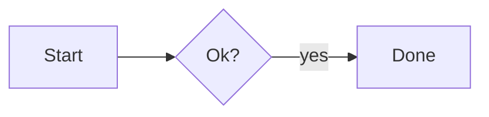

# Diagrams

A flowchart:



A sequence with a title after the word:

```Mermaid title="Login"
sequenceDiagram
  Alice->>Bob: Hi
```

A tilde fence:

~~~mermaid
graph TD
  X --> Y
~~~

A longer tilde fence holding a backtick fence:

~~~~mermaid
flowchart TB
  P["```"] --> Q
~~~~

A longer backtick fence:

````mermaid
graph LR
  M --> N
````

Not a diagram:

```mermaidx
kept as code
```
